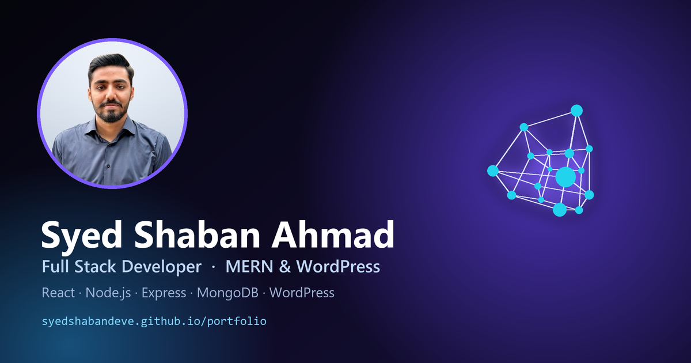

<div align="center">

# Syed Shaban Ahmad, Developer Portfolio

**Full Stack Developer · MERN, Shopify & WordPress · Lahore, Pakistan**

[](https://github.com/SyedShabanDeve/portfolio/actions/workflows/build.yml)
[](https://syedshabandeve.github.io/portfolio/)
[](https://react.dev)
[](https://threejs.org)
[](https://gsap.com)

<a href="https://syedshabandeve.github.io/portfolio/">
  
</a>

**[View it live](https://syedshabandeve.github.io/portfolio/)**

</div>

---

## What it is

A single-page portfolio built from scratch. The background is a tesseract, a four-dimensional
hypercube, rotating through the xw, yw and zw planes and projected into 3D on every frame, inside a
particle field that drifts through 4D simplex noise. Scrolling moves it through the page.

## Features

| | |
| --- | --- |
| **Real 4D scene** | 16 vertices and 32 edges rotated in four dimensions and perspective-projected to 3D in `src/three/HyperScene.js`. Edges are instanced cylinders with bloom; particles are a custom GLSL shader. |
| **Four themes** | Nebula, Inferno, Matrix and Daylight. The WebGL scene reads the theme's CSS variables, so switching recolours the 3D scene as well. The choice is stored and applied before first paint. |
| **Scroll choreography** | Lenis smooth scrolling drives GSAP ScrollTrigger: word-by-word statement reveal, a pinned horizontal project gallery with 3D card entrances, a timeline that draws itself, velocity-reactive marquees. |
| **Case-study spotlight** | The newest build, the Elite Zone Shopify store, gets its own section above the gallery: a browser frame that pans through the live homepage on its own and stays in view while you read, phone views, what was built and the numbers behind it. |
| **Interactive details** | Magnetic buttons, a custom cursor with context labels, holographic tilt on the photo and project cards, a pointer-driven 3D skills sphere, scramble text. |
| **Fast first paint** | three.js is loaded lazily in its own chunk. Rendering pauses in background tabs, and low-power devices get fewer particles and no bloom. |
| **Accessible** | Skip link, semantic landmarks, labelled controls, visible focus, and a `prefers-reduced-motion` mode that turns the motion off and renders the scene as a still. |
| **SEO and sharing** | Open Graph and Twitter cards, JSON-LD `Person` data, sitemap, robots and a web manifest. |

## Tech stack

| Layer | Choice |
| --- | --- |
| Framework | React 19, Vite 8 |
| 3D | three.js with UnrealBloomPass, custom GLSL shaders |
| Motion | GSAP + ScrollTrigger, Lenis |
| Styling | Hand-written CSS with custom properties, no framework |
| CI | GitHub Actions, lint and build on every push |
| Hosting | GitHub Pages via `gh-pages` |

## Running locally

```bash
npm install
npm run dev
```

Build and publish:

```bash
npm run build
npm run deploy
```

## Contact

- Email: [syedshaban785@gmail.com](mailto:syedshaban785@gmail.com)
- LinkedIn: [in/syedshaban785](https://www.linkedin.com/in/syedshaban785)
- GitHub: [SyedShabanDeve](https://github.com/SyedShabanDeve)

## License

MIT
